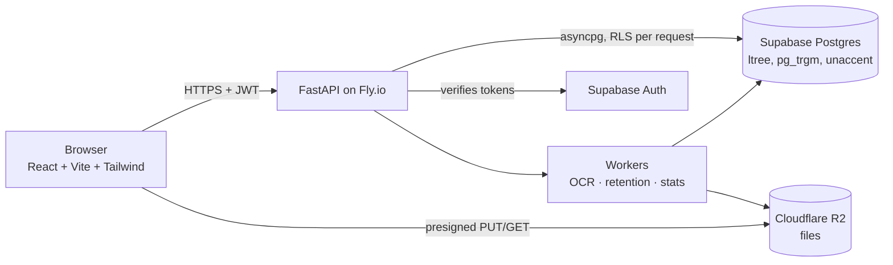

<p align="center">
  
</p>

<p align="center">
  Multi-company document management: OCR search, tax-deadline tracking, legal retention and a hash-chained audit trail.
</p>

<p align="center">
  <a href="https://github.com/alyssom-fernandes/Docke/actions/workflows/ci.yml"></a>
  <a href="LICENSE"></a>
</p>

<p align="center"><a href="README.pt-BR.md">Leia em português</a></p>


## In 30 seconds

- **Several companies, one place.** Each company has its own folder tree; access is granted per company or per folder and enforced by Postgres Row Level Security, not only by the API.
- **Find what is inside the files.** Scanned PDFs and images go through Tesseract OCR (Portuguese) in a background worker, and full-text search highlights the matching passage.
- **Deadlines and retention.** Tax obligations with alerts, retention policies that explain *why* a policy applies to a document, and an impact preview before assigning one.
- **Every action is recorded.** The activity log is chained per company with an HMAC over the previous hash, so editing a past entry breaks the chain.
- **Brazilian fiscal files.** A DANFE is rendered straight from the NF-e XML; DOCX/XLSX get a PDF preview through headless LibreOffice.

## Architecture



- The API forwards the user's JWT claims to Postgres (`set_config('request.jwt.claims')` + `SET LOCAL role authenticated`) inside one transaction per request, so the RLS policies apply to every query.
- Uploads go straight from the browser to R2 with presigned URLs (multipart from 20 MB, in 10 MB parts); the API only confirms the real size and computes the SHA-256 for deduplication.

## Stack

| Layer | Technology |
|---|---|
| Frontend | React 18, TypeScript (strict), Vite, Tailwind CSS, pdf.js |
| Backend | Python 3.11, FastAPI, asyncpg, python-jose |
| Data | Supabase (Postgres + Auth), 34 SQL migrations |
| Files | Cloudflare R2 (S3 API) |
| Processing | Tesseract OCR, LibreOffice headless |
| Hosting | Vercel (frontend), Fly.io (API) |

## Running locally

Requirements: Node 20+, Python 3.11+, Docker and the Supabase CLI.

```bash
supabase start                      # local Postgres + Auth, applies supabase/migrations
cd backend
python -m venv venv && source venv/bin/activate   # Windows: venv\Scripts\activate
pip install -r requirements.txt
cp .env.example .env                # fill in the keys printed by `supabase start`
python -m app.seed.demo_data        # 3 fictitious companies with documents
uvicorn app.main:app --reload --port 8000
```

```bash
cd frontend
cp .env.example .env
npm ci
npm run dev                         # http://localhost:5173
```

Without R2 credentials the API stores files on local disk (development mode).

## Tests

- `backend/tests`: 7 pytest integration tests (RLS, permissions, OCR sync, folder move, and the audit chain catching an edited or deleted event) against a real local Supabase.
- `frontend/e2e`: 4 Playwright specs (demo login, identity switch, PDF preview, search deep link).
- CI runs both on every push to `main`.

## Status and limitations

- The public demo depends on the API on Fly.io and on a Supabase project that is currently paused, so the demo button may report that the server is off.
- The interface is in Brazilian Portuguese only.
- The demo data is fictitious: company names are made up and the three CNPJs fail the check-digit validation, so they cannot belong to a real company.

## License

[MIT](LICENSE)
