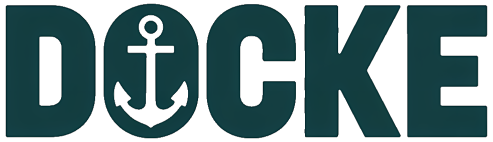
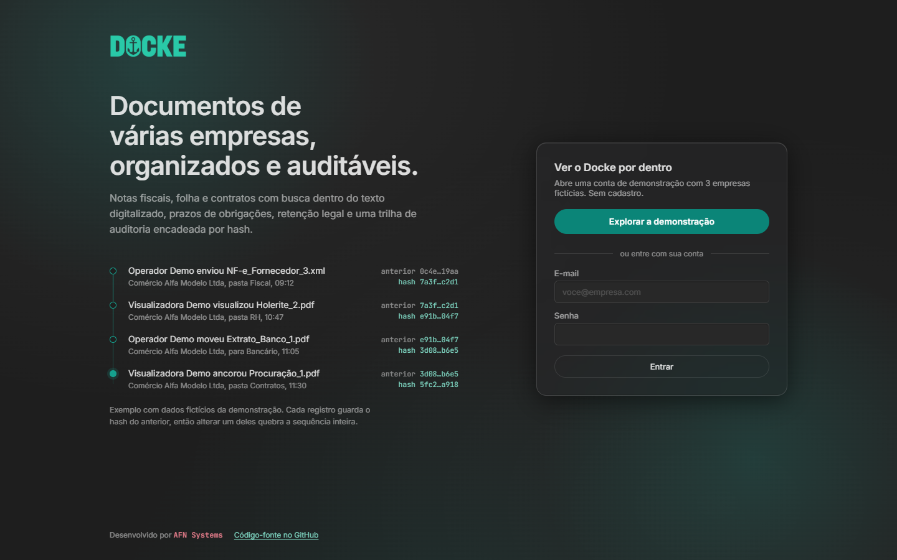
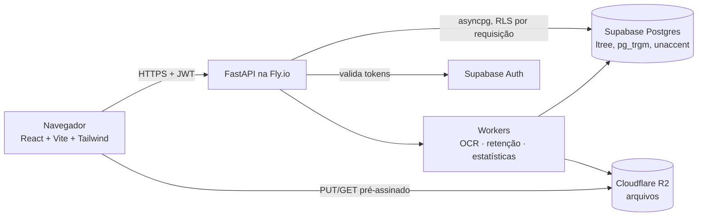

<p align="center">
  
</p>

<p align="center">
  Gestão eletrônica de documentos de várias empresas: busca com OCR, prazos de obrigações, retenção legal e trilha de auditoria encadeada por hash.
</p>

<p align="center">
  <a href="https://github.com/alyssom-fernandes/Docke/actions/workflows/ci.yml"></a>
  <a href="LICENSE"></a>
</p>

<p align="center"><a href="README.md">Read in English</a></p>



## Em 30 segundos

- **Várias empresas num só lugar.** Cada empresa tem sua árvore de pastas; o acesso é concedido por empresa ou por pasta e garantido pela Row Level Security do Postgres, não só pela API.
- **Busca dentro dos arquivos.** PDFs digitalizados e imagens passam por OCR (Tesseract, português) num worker em segundo plano, e a busca de texto completo destaca o trecho encontrado.
- **Prazos e retenção.** Obrigações fiscais com alertas, políticas de retenção que explicam *por que* valem para um documento e uma simulação de impacto antes de atribuir uma.
- **Toda ação fica registrada.** A trilha de atividades é encadeada por empresa com um HMAC sobre o hash anterior; alterar um registro antigo quebra a sequência.
- **Arquivos fiscais brasileiros.** O DANFE é montado direto do XML da NF-e; DOCX/XLSX ganham pré-visualização em PDF via LibreOffice headless.

## Arquitetura



- A API repassa as claims do JWT do usuário ao Postgres (`set_config('request.jwt.claims')` + `SET LOCAL role authenticated`) dentro de uma transação por requisição, então as políticas de RLS valem para toda consulta.
- O upload vai direto do navegador ao R2 por URL pré-assinada (multipart a partir de 20 MB, em partes de 10 MB); a API só confere o tamanho real e calcula o SHA-256 para deduplicação.

## Stack

| Camada | Tecnologia |
|---|---|
| Frontend | React 18, TypeScript (strict), Vite, Tailwind CSS, pdf.js |
| Backend | Python 3.11, FastAPI, asyncpg, python-jose |
| Dados | Supabase (Postgres + Auth), 35 migrations SQL |
| Arquivos | Cloudflare R2 (API S3) |
| Processamento | Tesseract OCR, LibreOffice headless |
| Hospedagem | Vercel (frontend), Fly.io (API) |

## Rodar localmente

Requisitos: Node 20+, Python 3.11+, Docker e o Supabase CLI.

```bash
supabase start                      # Postgres + Auth locais, aplica supabase/migrations
cd backend
python -m venv venv && source venv/bin/activate   # Windows: venv\Scripts\activate
pip install -r requirements.txt
cp .env.example .env                # preencha com as chaves que o `supabase start` imprime
python -m app.seed.demo_data        # 3 empresas fictícias com documentos
uvicorn app.main:app --reload --port 8000
```

```bash
cd frontend
cp .env.example .env
npm ci
npm run dev                         # http://localhost:5173
```

Sem credenciais do R2, a API guarda os arquivos no disco local (modo de desenvolvimento).

## Testes

- `backend/tests`: 8 testes de integração em pytest (RLS, permissões, sincronização do OCR, mover pasta, exclusão definitiva com link fixado numa versão e a trilha de auditoria detectando evento alterado ou apagado) contra um Supabase local real.
- `frontend/e2e`: 4 specs do Playwright (login demo, troca de identidade, preview de PDF, link direto da busca).
- O CI roda os dois a cada push na `main`.

## Situação e limitações

- A demonstração pública depende da API na Fly.io e de um projeto Supabase que está pausado no momento; por isso o botão da demo pode avisar que o servidor está desligado.
- A interface existe só em português do Brasil.
- Os dados da demo são fictícios: os nomes das empresas são inventados e os três CNPJs não passam na validação dos dígitos verificadores, então não podem pertencer a uma empresa real.

## Licença

[MIT](LICENSE)
